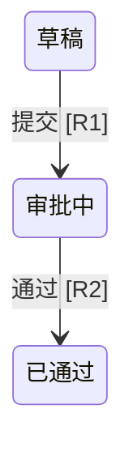

# Spec 与设计说明的图解表达

用户要求图解，或角色、状态、条件、交互和变更关系需要关联阅读时，按本方法选择表达。已有文字、表格或图稿足够就复用；纯文字要求、单条规则和局部改字不增加图稿。图解只作用于当前授权的说明，不自动启动完整分析、原型制作或文件写入。

## 先确定要解释的关系

读取当前规格、已确认决定、稳定词汇和实际原型，明确读者要判断什么。业务分析负责规则、状态和权限，产品设计负责交互；本方法负责呈现。发现业务冲突或缺失决定时指出具体影响，不能为了图形完整补造条件或结果。

| 当前问题 | 合适的表达 | 应保留的信息 |
|---|---|---|
| 规格目标、角色和业务边界 | 简短总览；必要时角色或范围图 | 主要任务、责任方、输入输出、非目标和详细规则入口 |
| 对象何时改变状态 | 状态图，条件复杂时配转换表 | 源状态、角色、触发、前提、目标状态、结果及禁止操作 |
| 用户如何完成任务 | 页面/任务流程、局部标注、动作反馈表 | 入口、输入、操作、校验、反馈、导航、退出和恢复 |
| 多个条件如何决定结果 | 决策表、局部分支或代表性案例 | 条件组合、优先级、边界、例外及未覆盖组合 |
| 谁能看见或操作哪些内容 | 权限表；多方交接时补协作图 | 对象和字段范围、操作、状态限制、拒绝表现 |
| 需求发生了什么变化 | 前后对照或局部差异 | 真实变化、影响的角色/状态/页面和对应验收 |

按当前问题选用，不要求六类齐全，也不为完整规格增加一套“图解版”。长资料可加总览和锚点导航，详细条件仍放在相关章节。代码调用树、组件树和技术架构不是 Spec 的默认产物。

## 状态与交互要表达准确

业务状态与界面显示状态分开。加载、空数据、禁用和请求失败不能直接当作业务状态；页面加载失败时可保留最后已知业务状态并说明未刷新，不能声称已经确认服务端最新状态。提交超时且结果不明时，不自行认定业务失败或允许重复提交，引用已有查询/恢复约定；没有约定就保留缺口。

每个重要转换能找到角色、触发、前提、目标状态和可观察结果。无权限或条件不满足时，说明是否保持原状态及用户反馈；终态、回退、撤回、重试和并发冲突按业务适用范围表达。来源未决定的转换留为待定，不画成已确认边。

交互说明围绕入口、输入、操作、反馈、离开与恢复组织。字段含义、校验、数据可见性、保存语义和草稿处理有依据才写确定行为。按钮隐藏不证明业务权限已实现；可点击外观不证明操作已实现。模拟数据、未实现动作和未运行的交互应明确标注。

复杂流程按任务或责任拆成局部视图，注明范围和跨图入口。不能只保留成功路径而省略当前问题相关的拒绝、失败或退出。决策表未列出的组合不暗示全部允许或全部拒绝。

## 同一业务事实只定义一次

图表靠近所支持的短说明，重要节点、条件和转换引用已有规则、章节或锚点，不强制新增编号。简单转换表可以直接承载规则；长规则保留一个权威位置。总览省略细节时给出详细入口，重要权限、例外和恢复不能仅藏在颜色或远处脚注里。

改规则时核对本次影响的图表、交互说明和验收；改图时反查是否改变业务语义。只同步授权范围内的材料，范围外差异指出位置和影响。图文冲突且来源不明时不能静默选择一方。

Before 必须来自可访问的旧材料；没有旧版本就解释当前提案和历史限制，不虚构差异。明确区分已确认、提案、未知和模拟，不因图形整齐而抹去未决项。

## 选择可实际阅读的形式

优先采用目标文档支持的文字、表格、Mermaid 或已有图稿格式，不强制格式迁移。不支持 Mermaid 时给出同源的可读表格或文字，必要时附可访问图稿；没有实际查看目标渲染，只能报告内容核对，不能声称显示通过。

只有现有形式难以表达局部比较或关系时，才在授权范围内制作单页 HTML。默认自包含、离线可读，不主动引入 CDN、在线图表服务或上传业务资料；可复用已授权的项目环境。沿用目标项目路径，保护同名成果；按实际宿主预览能力打开，不写死 `open` 或自动安装浏览器、依赖。

保留清楚的标签、合理窄屏布局和适用的键盘访问，颜色不作唯一语义。未实际打开时交付文件引用并说明未预览，不能称用户已看到。静态图与 HTML 说明不证明交互已验证，正式原型的验证仍由内容负责人完成。

## 教学样例：只消费给定规则

以下内容仅演示表达方法，不能复制为真实产品规则或 Context。

### 状态与条件

假设输入已明确：R1，申请人只能提交自己的草稿，必填项完整才进入审批中；R2，指定审批人只能通过分配给自己的审批中申请，通过成功后进入已通过；R3，不满足条件时业务状态不变并提示原因。输入没有定义撤回、驳回或进入已通过后的行为。

| 源状态 | 角色与动作 | 条件 | 结果与依据 |
|---|---|---|---|
| 草稿 | 申请人提交 | 本人申请且必填项完整 | 进入审批中，R1 |
| 审批中 | 指定审批人通过 | 当前申请分配给本人 | 进入已通过，R2 |
| 当前状态 | 上述动作被拒绝 | 对应条件不满足 | 状态不变，提示原因，R3 |

图只展示 R1、R2 的转换，拒绝结果见 R3。撤回角色、目标状态和其他未给出的行为仍待确认；不增加撤回边，也不把“未定义”改写成“禁止”。

### 交互失败与恢复

另一个教学输入明确：编辑草稿保存失败时保留输入、提示失败并允许重试；用户尚未决定关闭编辑器时如何处理未保存内容。

| 用户动作/条件 | 可观察反馈 | 恢复与限制 |
|---|---|---|
| 保存草稿失败 | 显示失败提示，输入仍在 | 可重试；不声称保存成功 |
| 关闭有未保存内容的编辑器 | 尚未决定 | 待确认保留、放弃或提示方式，不能凭习惯选一个 |

这是交互说明，不是已经操作过原型的证据。若只有页面加载失败，说明最后已知业务状态和未刷新限制，不把对象改成“保存失败”状态。

### 规则变化与图文冲突

教学旧材料明确“部门内审批人均可通过”，新确认改为“仅指定审批人可通过”。前后对照应突出操作主体收窄，并核对受影响的转换条件、权限说明、交互反馈和验收。若旧图仍标“部门审批人”，指出该节点并按新决定同步；没有新旧权威来源时先保留冲突。

若输入只给出了新规则而没有可访问旧版本，写当前规则及“历史行为未核验”，不推断原先谁能操作。只修改字段名的请求保持局部修改，不顺带生成差异图。

## 交付前核对

对照输入检查角色、条件、量词、顺序、状态、例外和未决项；确认图文引用一致，实际改动没有扩大业务承诺。记录实际观察范围：内容核对、渲染检查、原型操作分别说明。不能用图表数量、文件存在或作者自评证明读者理解改善。

表达选择与最小视图方法参考 [HumanLayer show-me 固定版本](https://github.com/humanlayer/skills/blob/69d5fc61d6ca6f7056d283a2ee2a045be741a1d6/plugins/show-me/skills/show-me/SKILL.md)，版权许可见 [ShowMe MIT 声明](show-me-LICENSE.txt)。
